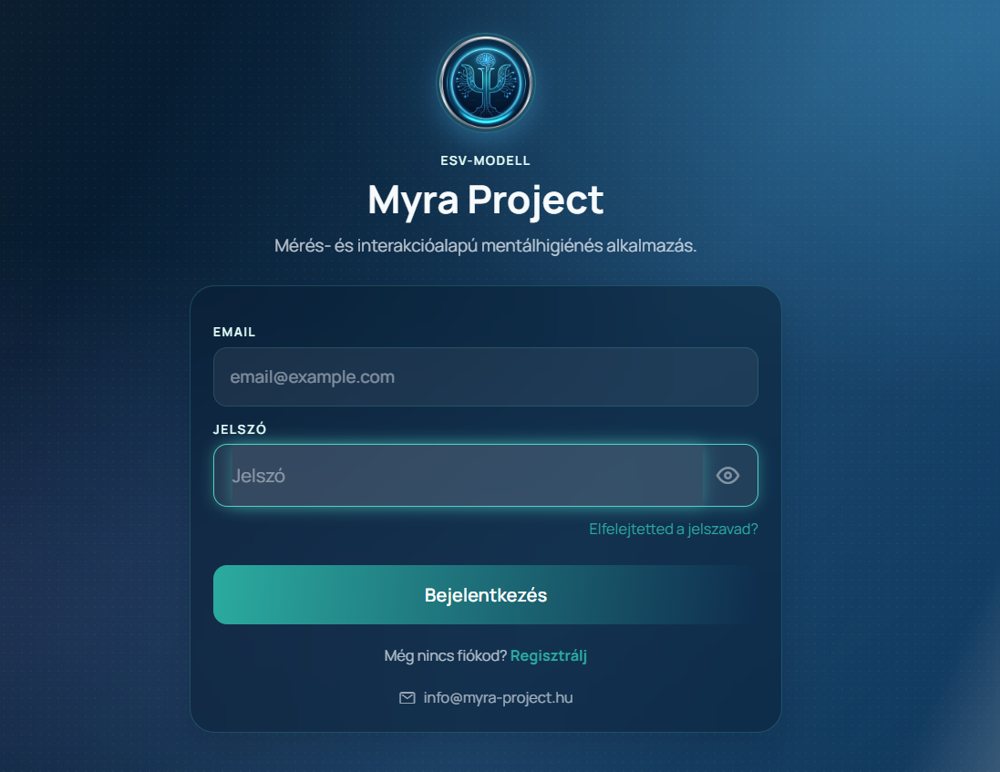
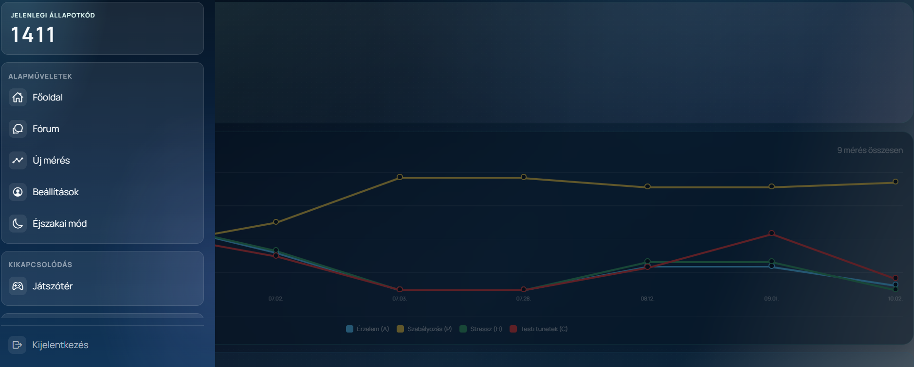

# Myra Project

**Élő platform:** <https://myra-project.hu>

<p align="center">
  
  &nbsp;
  
</p>

Magyar nyelvű mentálhigiénés önismereti webapp. A rendszer ESV-modell alapú mérést végez, állapotkódot számol, majd a mérés eredményére építve indít beszélgetést a Myra chatfelületen.

Fontos: a Myra nem hivatalos diagnosztikai vagy terápiás eszköz, és nem helyettesít szakembert.

## Éles Architektúra

```text
Felhasználó böngészője
  |
  v
myra-project.hu (a ház nyilvános IP-címe) → router port-forward (80/443)
  |
  v
Caddy (a backend szerveren, ugyanazon a domainen)
  - Let's Encrypt tanúsítvány, automatikus megújítással
  - HSTS és biztonsági fejlécek, CSP, kérésméret- és időkorlátok
  - statikus frontend a /srv/myra mappából (azonos eredet az API-val)
  - /api/* reverse proxy a 127.0.0.1:8001-re, X-Myra-Proxy-Secret fejléccel
  - hozzáférési napló: /var/log/caddy/myra-access.log (fail2ban figyeli)
  |
  v
Saját szerver (Ubuntu, hostnév: backend, <backend-ip>, Magyarország)
  - Docker Compose, projekt: myra (myra-backend, myra-docker-socket-proxy)
  - FastAPI / Uvicorn, csak 127.0.0.1:8001-en figyel
  - helyi RAG: multilingual-e5-large (1024 dim) + bge-reranker-base
  - myra-watch: integritás- és eseményfigyelő, automatikus karanténnal
  - óránkénti pg_dump mentés (~/myra-backups), a modellszerverre is átmásolva
  |
  v
Supabase EU Postgres (Írország, eu-west-1)
  - felhasználók, mérési adatok, chat előzmények, profil-kivonatok
  - knowledge_chunks + pgvector embedding_1024
  - IP-korlátozás: csak a szerver publikus IP-je
```

A helyi nyelvi modell **külön gépen** fut, a backend szerverrel WireGuard-alagúton összekötve:

```text
backend szerver (<backend-ip>)  ←→  modellszerver (myrallm, <llm-ip>)
  - WireGuard: <backend-wg-ip> ↔ <llm-wg-ip>
  - a llama-server KIZÁRÓLAG a <llm-wg-ip>-n figyel, a LAN-ról nem érhető el
  - a backend OLLAMA_BASE_URL értéke: http://<llm-wg-ip>:8080
```

**2026-10-04 óta** a backend nem a Google Cloud VM-en, hanem a saját, otthoni Ubuntu
szerveren fut Docker konténerben. **2026-10-13 óta** a frontend is innen megy: a Caddy
szolgálja ki a `/srv/myra` mappából, ugyanazon a domainen, mint az API. A Cloudflare Tunnel
és a Vercel megszűnt, a DNS zóna a Rackhost/dns24 névszerverein van. Helyi adatbázis a
szerveren **nincs és nem is lehet**: minden adat a Supabase-ben van.

**A ház IP-címe nem fix.** A DNS-rekordokat (`myra-project.hu` és `www` → a ház nyilvános
IP-je) a Rackhost zónaszerkesztőjében **kézzel** kell frissíteni, ha a szolgáltató új címet
ad — automatikus DDNS egyelőre nincs. Ugyanez az IP szerepel a Supabase allowlistjén is,
tehát egy címváltás a DNS-t és az adatbázis-elérést is érinti.

> A README további részeiben előforduló „VM” a backend szervert jelenti. A Google Cloud-
> specifikus részek (GCP tűzfal, IAP, e2-micro mérések) történeti feljegyzések.

## Fő Funkciók

- felhasználói regisztráció, bejelentkezés és MFA email kód;
- ESV-modell alapú kérdőív és állapotkód-számítás;
- mérési eredményoldal sávonkénti szöveges eredmény-értelmezéssel;
- mérés utáni mikro-cél javaslatok, cél-követés a főoldalon, a célok chat-kontextusba illesztésével;
- proaktív Myra check-in: néhány nap kihagyás után Myra támogató visszakérdezéssel nyitja újra a beszélgetést (admin-beállítás: proactive_checkin_days, 0 = ki);
- ESV25 Inventory szakemberi PDF-összefoglaló (Myra Project arculat, kiemelt figyelmeztetés, teljes módszertani és POMP-transzparencia);
- méréshez kötött Myra chat;
- chat- és mérési előzmények;
- bővített chat kontextus ugyanazon mérési szálon belül;
- TXT beszélgetés-export a chat felületről;
- asztali gépen Enterrel küldés a chatben (Shift+Enter új sor);
- visszajelzés gomb a chat felületen, közvetlen e-mail-küldéssel a fejlesztőnek (Proton Mail);
- fórum-értesítés: jelzés a menüben és a menügombon, ha új poszt érkezett;
- felhasználói adathordozhatóság (GDPR Art. 20) adatexporttal JSON formátumban;
- felhasználói fiók és adatok végleges önkiszolgáló törlése (GDPR Art. 17);
- Fórum (csoportos üzenőfal) egyedi becenevekkel, 12 választható emoji-avatarral, magyar trágárságszűrővel és szerzői/adminisztrátori törlési jogkörökkel;
- Játszótér (Kikapcsolódás): kifestő, memóriajáték, kígyó és sudoku, globális ranglistával és választható becenévvel;
- PDF-alapú hibrid (pgvector + magyar full-text, RRF) RAG tudásvisszakeresés relevancia-küszöbbel;
- FastEmbed in-memory normalizált embedding gyorsítótár a válaszok gyorsításához és erőforrás-takarékossághoz;
- admin tudásanyag-kezelés PDF feltöltéssel, törléssel és háttérben futó élesítéssel;
- admin rendszerbeállítások, karbantartási mód és SOS eszközök;
- biztonsági adminisztrátori audit naplózás és megerősített brute-force védelem;
- 30 napos mérési érvényességi ciklus és archivált, olvasható beszélgetések;
- „Myra memóriája”: külön hozzájárulással, a korábbi mérésekből, célokból és beszélgetésekből képzett esetösszefoglaló (bekapcsoláskor azonnal, visszamenőleg elkészül; mezők: visszatérő témák, saját szavai, ismétlődő mintázatok, erőforrások, ami levezetett / nem működött, célok és elmozdulás, nyitott szálak), valamint jelentés szerinti felidézés: a felhasználói üzenetek a helyi e5-large modellel vektort kapnak (`chat_message_embeddings`), Myra a hasonló korábbi helyzeteket a múltra utalás nélkül is előhozhatja (újrarangsoroló küszöbbel: `RECALL_PROACTIVE_MIN_SCORE`, `RECALL_EXPLICIT_MIN_SCORE`); kikapcsoláskor a vektorok törlődnek;
- admin felületen felhasználónkénti profilnézet (megtekintés, újraképzés, törlés);
- admin adatbázis-mentés letöltés: a legfrissebb óránkénti, tudásanyag-index nélküli felhasználói mentés (`userdata-*.sql.gz`);
- karbantartás / karantén alatt a felhasználók tájékoztató oldalt látnak (`MaintenanceGate`), a karbantartás végén az oldal magától újratöltődik;
- saját szerveren futó frontend és backend (Caddy), Supabase adatbázis.

## Stack

### Backend

- Python 3.11 / 3.12
- FastAPI
- SQLAlchemy async
- asyncpg
- Supabase/Postgres
- pgvector
- FastEmbed 0.8.0 (rögzítve): `intfloat/multilingual-e5-large`, 1024 dimenziós lokális embedding, `BAAI/bge-reranker-base` újrarangsoroló, in-memory caching
- pypdf PDF szövegkinyerés
- JWT auth
- Proton Mail (Mail Plus) a rendszerlevelekhez: saját domain (`info@myra-project.hu`),
  a Proton SMTP-beküldőjén keresztül — lásd *E-mail (Proton Mail)* és
  `docs/email-proton-atallas.md`
- Docker / Docker Compose
- LLM provider admin felületről konfigurálva: OpenAI, Anthropic, Gemini, Groq, Cerebras, Mistral,
  valamint **Ollama-kompatibilis helyi modellszerver** (`llama.cpp` `llama-server` a `myrallm`
  gépen, WireGuard-alagúton elérve: `http://<llm-wg-ip>:8080`, API kulccsal)
- Statikus kód- és függőség-sérülékenység ellenőrzés (bandit, pip-audit)
- Automatizált pytest tesztcsomag (biztonsági és megfelelőségi tesztek: OWASP szűrések, JWT token érvényesség, MFA ellenőrzés, biztonsági HTTP fejlécek validálása és GDPR megfelelőségi folyamatok)

### Frontend

- Expo Router
- React Native Web
- TypeScript
- telepítés a saját szerverre (`npm run deploy`)
- Expo web export

## Design Irány

A Myra jelenlegi arculati iránya az **Aurora Blue dark calm** rendszer. Ez egy sötét, nyugodt, minimalista,
üvegszerű felület, amely a beszélgetést és a mérést helyezi előtérbe. A design forrása:

```text
design_guidelines.json
frontend/src/theme.ts
frontend/src/components/ContentBackground.tsx
frontend/src/components/TopBar.tsx
```

### Nappali / éjszakai mód (2026-08-16)

A menüben (Alapműveletek → Beállítások alatt) váltható. Az éjszakai mód klasszikus sötét
mód: sötét kártyák, világos szöveg, a színátmenet világos vége is beborul.

A megvalósítás azért nem JS-alapú, mert **27 képernyő modulszintű `StyleSheet.create`-et
használ**, ami importáláskor egyszer fut le és beégeti a színt — egy futásidejű
témaváltás azoknál nem érne semmit. Helyette a mód-függő tokenek CSS-változóra mutatnak
(`var(--myra-...)`), amit a böngésző festéskor old fel, így egyetlen attribútum
átbillentése átszínez mindent, újrarenderelés nélkül:

```text
frontend/scripts/theme-tokens.css   <- a paletta EGYETLEN forrása
frontend/scripts/patch-dist.js      <- build után beszúrja a dist/index.html <head>-jébe
frontend/src/theme.ts               <- a tokenek var(--myra-*)-ra mutatnak (weben)
frontend/src/themeMode.ts           <- a kapcsoló, localStorage-ba ment
```

Ezt a React Native Web és az `expo-linear-gradient` is szándékosan támogatja: mindkettőben
van egy `isWebColor` ellenőrzés, ami a `var(`-ral **kezdődő** stringet érintetlenül
továbbengedi. A `var(` csak a string elején állhat — `"rgba(var(--x), 0.5)"` már nem megy át.

**A paletta NEM az `app/+html.tsx`-ben van.** Az `app.json`-ban `web.output: "single"`, és
ilyenkor az Expo Router nem használja a `+html.tsx`-et, hanem a saját sablonjából generál
`index.html`-t — a fájl tartalma soha nem kerül a buildbe. Ha valaha `output: "static"`-ra
váltasz, a `theme-tokens.css` tartalmát oda is be kell húzni.

Natívon (iOS/Android) nincs CSS-változó, ezért ott a nappali paletta fix értékei élnek.

Design módosításnál az alapelv: a működő app-felület maradjon az első képernyő, ne marketing landing page
legyen belőle. A chat felület maradjon alacsony zajszintű, gyors, könnyen olvasható és mobilon is
stabil. Új színpaletta, nagyobb vizuális átalakítás vagy Myra promptot érintő változtatás csak külön jóváhagyással
kerülhet be.

## Fontos Működési Részletek

### ESV normalizálás — v2 (POMP, 2026-07-02)

A kvíz normalizálása a pszichometriában standard POMP-skálázást használja (percent of maximum possible): `(összeg − minimum) / (maximum − minimum)`. Képletek: `A(t)=(xa−6)/24`, `P(t)=1−(xp−6)/24`, `H(t)=(xh−4)/16`, `C(t)=xc/10`.

A v1 (2026-07-02 előtt) csak a maximummal osztott, ezért az A/P/H dimenziók nem érték el a skála szélét; a P-nél emiatt a 4-es bucket ("erős érzelemszabályozás") érvényes kitöltésből elérhetetlen volt. A v2 lineáris átskálázás: a kitöltők sorrendjét és a dimenziók közötti korrelációkat nem változtatja meg, de a határközeli kitöltők bucketje eltolódhat. Az új mérések `norms` mezőjében `"v": 2` jelzi a verziót; a régi (v1) mérések változatlanul maradnak, és a 30 napos ciklus végén maguktól lejárnak. A számítási referencia (`backend/data/esv_calc.ods`, ill. a gyökérben az `ESV_Calc1_egyéni_v2.ods`) ugyanezeket a képleteket tartalmazza, üressor-védelemmel (üres adat-sor nem kap értéket és diagnózist).

### Frontend és API kiszolgálás (azonos origin)

A böngészőből induló API hívások `/api/...` útvonalra mennek, **ugyanarra a domainre**, amiről
a felület betöltődött. A statikus frontendet és a `/api/*` kéréseket is a szerveren futó
**Caddy** szolgálja ki:

- a `/srv/myra` mappából kiszolgálja az Expo web buildet;
- a `/api/*` kéréseket továbbítja a `127.0.0.1:8001`-re (a backend konténerhez);
- a továbbított kérésekhez hozzáadja a `X-Myra-Proxy-Secret` fejlécet;
- TLS-t bont, HSTS-t és biztonsági fejléceket ad, és a hozzáférési naplót írja.

Mivel a felület és az API **azonos originen** van, nincs Vercel-proxy, nincs CORS és nincs
`vercel.json`-rewrite: a böngésző közvetlenül a `/api/...` útvonalat hívja.

### Backend origin védelem

A backend csak akkor fogad el éles külső kérést, ha a kérésben szerepel a helyes:

```text
X-Myra-Proxy-Secret
```

Ha ez hiányzik vagy rossz, a backend válasza:

```json
{"detail":"Direct access to origin is forbidden."}
```

A `.env` (`MYRA_PROXY_SECRET`) és a Caddy ugyanazt az értéket használja: a titkot a Caddy
fűzi be a `/api/*` kérésekhez (`/etc/caddy/myra.env`, amit a `caddy.service` systemd drop-in
tölt be). A titok így a szerveren marad, a böngészőbe nem kerül.

A teljes lánc kívülről befelé:

| réteg | mit csinál | hol van beállítva |
|---|---|---|
| 1. router + tűzfal | kifelé csak a 80/443 van nyitva; a backend `127.0.0.1:8001`-en figyel, tehát a LAN-ról sem érhető el | router port-forward, `docker-compose.yml`, UFW |
| 2. Caddy | TLS + biztonsági fejlécek, kérésméret- és időkorlátok, hozzáférési napló, fail2ban-tiltás | `/etc/caddy/Caddyfile` |
| 3. proxy-titok | a `/api/*` kérésekhez a Caddy fűzi be; a backend csak így fogad | `MYRA_PROXY_SECRET` a `.env`-ben és a Caddy környezetében |

A `/api/config` az egyetlen útvonal, amit a backend loopbackről titok nélkül is átenged (ezt
használja a konténer healthcheckje és a karbantartási kapu).

Ellenőrzés kívülről:

```bash
curl -i https://myra-project.hu/                        # 200, a Caddy szolgálja ki a frontendet
curl -i https://myra-project.hu/api/config              # 200 (loopback-exempt útvonal)
curl -m 5 http://<SZERVER_PUBLIKUS_IP>:8001/api/config  # timeout: a backend nem publikált
```

A backend közvetlen elérését a 2. és 3. réteg együtt zárja: a 8001-es port sem kívülről, sem
a LAN-ról nem érhető el (a backend kizárólag a loopbacken figyel), a proxy-titok nélküli
kérés pedig `403`-at kap.

### Szerver tűzfal (2026-10-13 óta)

| szabály | forrás | port | állapot |
|---|---|---|---|
| HTTP / HTTPS | `0.0.0.0/0` | tcp:80, tcp:443 | aktív — a publikus webes forgalom (ide érkezik a router port-forwardja) |
| SSH | `<lan>/24` | tcp:22 | aktív — csak a helyi hálózatról |
| minden más bejövő | — | — | tiltva (UFW alapértelmezés) |

A backend a compose-ban `127.0.0.1:8001:8001`-re van kötve, tehát a helyi hálózatról sem
érhető el — kizárólag a szerveren belülről, a Caddy-n át. Ellenőrzés:

```bash
sudo ufw status numbered
ss -tln | grep -vE '127\.0\.0|::1'   # 22, 80 és 443 maradhat (a 80/443-at a Caddy tartja)
```

### GCP tűzfal állapota (történeti, 2026-08-14 – 2026-10-04)

| szabály | forrás | port | állapot |
|---|---|---|---|
| `allow-ssh-iap` | `35.235.240.0/20` | tcp:22 | aktív — csak IAP-n át |
| `default-allow-ssh` | `0.0.0.0/0` | tcp:22 | **letiltva** |
| `default-allow-rdp` | `0.0.0.0/0` | tcp:3389 | **letiltva** |
| `allow-myra-backend-8001` | `0.0.0.0/0` | tcp:8001 | **letiltva** |
| `default-allow-internal` | `10.128.0.0/9` | minden | aktív |
| `default-allow-icmp` | `0.0.0.0/0` | icmp | aktív |

A gépen egyetlen TCP-port sem nyitott az internet felé. Az SSH a Google Cloud Console
SSH gombján keresztül megy, ami IAP-t használ — ha valaha közvetlenül, a publikus IP-re
akarnál SSH-zni, előbb a `default-allow-ssh`-t kell visszakapcsolni:

```bash
gcloud compute firewall-rules update default-allow-ssh --no-disabled
```

### Supabase IP allowlist

A Supabase Database → Settings → Network Restrictions alatt **csak a szerver publikus IP-je**
van engedélyezve (`<SZERVER_PUBLIKUS_IP>/32`). A régi Google VM címe 2026-10-04-én kikerült.

**Az otthoni internet IP-címe nem fix.** Ha a szolgáltató megváltoztatja, a backend nem éri
el az adatbázist (`EADDRNOTALLOWED`), és a Myra leáll. Ilyenkor az új IP-t kell felvenni az
allowlistre. Az aktuális cím: `curl -s ifconfig.me` a szerveren.

A frontend és a backend ugyanarról a szerverről megy, ezért a Supabase allowlistjén csak ez
az egy cím szerepel; a böngésző sosem kapcsolódik közvetlenül az adatbázishoz.

## RAG / Tudásanyag

> **2026-10-04 óta** az éles kereső a saját szerveren fut: `intfloat/multilingual-e5-large`
> (1024 dim, `query: ` / `passage: ` előtaggal), `BAAI/bge-reranker-base` újrarangsoroló,
> darabolás 1500 / 250 / 300 karakter, 60 jelölt, 6 részlet a válaszhoz. A vektorok a
> `knowledge_chunks.embedding_1024` oszlopban vannak (924 részlet / 69 forrás az első
> újraindexelés után). Az `embedding_384`-re és a MiniLM modellre vonatkozó leírások lentebb
> történetiek; az ellenőrző lekérdezésekben `embedding_384` helyett `embedding_1024` értendő.
> A beállítások a `docker-compose.override.yml`-ben vannak (`FASTEMBED_MODEL_NAME`,
> `EMBED_DIM`, `RAG_*`). Újraindexelés: admin felület → Tudásanyag → újraindexelés.

A tudásanyag PDF-ekből épül:

```text
backend/data/kb_pdfs/*.pdf
```

A PDF feltöltés backend oldalon méretkorlátot és PDF tartalomellenőrzést kap. Az alapértelmezett
limit 25 MB/fájl, env-ből hangolható:

```env
KB_PDF_UPLOAD_MAX_BYTES=26214400
KB_TEXT_UPLOAD_MAX_BYTES=2097152
```

### Keresési pipeline (2026-07-03 óta)

Postgres/Supabase alatt a keresés hibrid: pgvector cosine keresés és magyar szótövezett
full-text ág (`to_tsquery('hungarian')`, GIN indexszel) fut egy SQL-ben, az eredmény
RRF-fúzióval áll össze. SQLite (fejlesztői) módban FTS5/BM25 keresés fut. A chunkolás
**400 karakter / 80 átfedés** (2026-08-18 előtt 1400/200 volt — lásd lentebb), az
embedding a dokumentumcímmel együtt készül. A modellt
egy háttérfolyamat tartja melegen, hogy kevés RAM-ú VM-en se swapoljon ki tétlenség
alatt.

**Változás 2026-08-13:** a szöveges ág korábban `websearch_to_tsquery`-t használt, ami a
szavakat ÉS-sel köti össze — így egy valódi mondatra soha nem talált, mert minden szónak
ugyanabban a chunkban kellett volna szerepelnie. Helyette VAGY-alapú `to_tsquery` épül a
lekérdezésből, a 7 karakternél hosszabb szavak prefixként (`ambivalencia:*`), mert a
magyar szótövező külön lexémát csinál az `ambivalencia` és az `ambivalens` alakból.

2026-08-13-tól 2026-08-17-ig a találati szűrés ki volt kapcsolva: a rangsor élén álló
`limit` darab chunk **mindig** átment az LLM-hez, akármilyen laza volt az illeszkedés.

**Változás 2026-08-17 — két hiba a chat promptjában.**

*Első:* a keresés nem arra futott, amit a felhasználó éppen írt. A `_build_chat_kb_query`
a rövid üzeneteket „feldúsította": négynél kevesebb érdemi szó esetén az ELŐZŐ
user-üzenetet és az állapotprofilt is beletette a lekérdezésbe. Mérés: a `szia` 0,493-as
találati értéket kapott és öt PDF-részletet hozott, mert nem a `szia`-ra keresett.
Mostantól a keresés **mindig az aktuális input üzenetre** megy; ha abban egyetlen érdemi
szó sincs, a keresés elmarad.

*Második:* nem volt „csak ha van releváns" ág. A `RAG_VECTOR_MAX_DISTANCE` konstans
definiálva volt, de a kód **sehol nem használta** — a szűrő meg volt írva, csak nem volt
bekötve. Mostantól szűr: a küszöb feletti találatok kimaradnak, és ha egy sem elég közeli,
nem megy tudásanyag-blokk a promptba.

A kettő együtt adja azt, hogy a részletek száma az üzenethez igazodik. Mért példa
(2026-08-17): `kept=1..2` hétköznapi üzenetnél, `kept=5` témába vágónál; a prompt mérete
ezzel együtt 10 600 és 15 900 karakter között mozog.

**Változás 2026-08-18 — a beágyazó modell 128 tokennél elvágott mindent.**

A `paraphrase-multilingual-MiniLM-L12-v2` `max_seq_length` értéke **128 token**. Magyar
szakszövegen ez kb. **500 karakter**: efölött a szöveg vége nem kerül bele a vektorba.
Cloud Shellben mérve, valódi tudásanyag-részleten: 500 karakternél az eltérés már csak
0,117, **550-nél pontosan 0,000000** — vagyis a farok láthatatlan.

A régi 1400-as darabolással ez azt jelentette, hogy **980 részletből 825 (84%) csonkolva
indexelődött**, és a tudásanyag **601 619 karaktere — 57% — soha nem került be a
szemantikus keresésbe**. A kulcsszavas ág (`to_tsquery`) viszont a teljes szöveget látja,
ezért az hordta a rendszert: a szöveges találatok hoztak olyasmit, amit a vektoros ág meg
sem talált.

Javítás: a darabolás **400 karakter / 80 átfedés**, hogy a dokumentumcímmel együtt
(leghosszabb cím 77 karakter) is beleférjen az ablakba. Mérés utána: 67 PDF, ~3100
részlet, **nulla 400 karakter fölött, nulla embedding nélkül**, a tudásanyag 100%-a
kereshető a 43% helyett.

**A darabolót is javítani kellett** (2026-08-18): a régi verzió pontos karakterpozícióra
vágott, ezért szó közepén tört, és a bekezdés végén pár karakteres törmelék maradt
(`.`, `lja`, `ás).`, `zsgálatát.`). 1400-as mérettel ez nem tűnt fel, 400-asnál 3166
darabból 108 lett ilyen. Mostantól **szóhatáron vág**, a következő darab mindig legalább
egy új szóval kezdődik (csak-átfedésből álló darab nem jöhet létre), és a szóköz nélküli
hosszú szövegek (URL, táblázat, hibás PDF-kinyerés) karakterre vágódnak, hogy azok se
lépjék túl az ablakot.

**Mérés az újradarabolás után (2026-08-18, irányított teszt).** Öt témapár, egyszer
szaknyelven, egyszer hétköznapi megfogalmazásban:

| kérdés | `best_dist` |
|---|---|
| Mit jelent a koreguláció a csoportban? | 0,368 |
| Miért nyugszom meg attól, ha valaki higgadt marad mellettem? | 0,382 |
| Hogyan zárul le a gyász pszichofiziológiailag? | 0,160 |
| Egy éve halt meg apám, és még mindig ugyanúgy fáj. | 0,555 |

Mind a tíz talált, és a hétköznapi megfogalmazás nem rosszabb — ez volt a cél. A prompt
mérete 15 500-ról **11 300 karakterre** esett, a RAG-idő 2-11,5 mp-ről **0,2-1,1 mp-re**.

**Nyitott, tudatosan meghagyva:** a `RAG_VECTOR_MAX_DISTANCE` küszöb a **csak szöveges**
találatokra nem vonatkozik (nincs vektortávolságuk, ezért a szűrő feltétele nem fog
rájuk). Emiatt zajos kérdésre is bemehet 3-5 részlet. Mérés szerint viszont a hétköznapi,
valódi üzenetek egy részét is **ez az ág menti meg** (0,566-0,637-es vektortávolság
mellett), ezért a kiskapu bezárása találatvesztéssel járna. A rendszerprompt amúgy is
elhárítja a nem mentálhigiénés kérdéseket, tehát a zaj tokent és időt visz, nem
válaszminőséget.

RAG-hoz hangolható env változók:

```env
RAG_CHAT_CHUNKS=5
RAG_VECTOR_MAX_DISTANCE=0.62
RAG_CANDIDATE_POOL=20
RAG_KEEPWARM_INTERVAL_S=240
RAG_CHUNK_MAX_CHARS=400
RAG_CHUNK_OVERLAP=80
RAG_CHUNK_MIN_CHARS=120
DISABLE_RAG_STARTUP_WARMUP=false
FASTEMBED_MODEL_NAME=sentence-transformers/paraphrase-multilingual-MiniLM-L12-v2
```

- `RAG_CHAT_CHUNKS`: hány részlet mehet legfeljebb egy chat-üzenethez. `0` esetén a keresés is elmarad — ez a 2026-08-12 (a tudásanyag újraindexelése) előtti állapot, és kérésenként 2-8 másodpercet spórol.
- `RAG_VECTOR_MAX_DISTANCE`: 2026-08-17 óta **ténylegesen szűr**. Kisebb szám = szigorúbb. `1.0` kikapcsolja.
- `RAG_CANDIDATE_POOL`: a hibrid fuzio jeloltszama aganként.
- `RAG_CHUNK_MAX_CHARS` / `RAG_CHUNK_OVERLAP` / `RAG_CHUNK_MIN_CHARS`: a darabolás mérete,
  átfedése és az a minimum, amely alatt a darab beolvad az előzőbe (ha belefér). **A
  400-as alapérték a beágyazó modell 128 tokenes ablakához igazodik — feljebb véve a
  darabok vége megint kimarad az indexből.** Változtatás után **újraindexelés kell**,
  különben a régi vektorok maradnak.
- `RAG_KEEPWARM_INTERVAL_S`: keep-warm gyakorisag masodpercben; `0` kikapcsolja.
- `DISABLE_RAG_STARTUP_WARMUP=true`: kikapcsolja a startup RAG warmupot, ha gyors kontenerinditas fontosabb az elso RAG keresesi kesleltetesnel.

**FIGYELEM — ezek a változók csak akkor élnek, ha a `docker-compose.yml` át is adja őket.**
2026-08-17-ig egyikük sem szerepelt az `environment:` listában, ezért a kód mindig a
beépített alapértékkel futott, hiába állította bárki a `.env`-ben. Ugyanez a hiba volt
korábban a `TTS_ENGINE`-nél. Ha új változót veszel fel, a compose-ba is fel kell venni.

Diagnosztika: minden keresés `rag_search candidates=... txt_hits=... kept=... best_dist=...`
sort logol. A `txt_hits` a szöveges ág találatait mutatja — ha tartósan 0, a lexikális ág
nem dolgozik. A `scripts/bench_embed.py` a konteneren belul meri a modell betoltesi
idejet, query-latencyt es RAM-igenyt.

A backend a PDF-ekből szöveget nyer ki, chunkokra bontja, FastEmbed embeddinget készít, majd Supabase-ben tárolja:

```text
knowledge_chunks.embedding_384 vector(384)
```

Az aktív oszlop:

```text
embedding_384
```

A régi 768 dimenziós `embedding` oszlop már nem használatos.

### Supabase elvárt ellenőrzés

```sql
select
  count(*) as chunks,
  count(embedding_384) as embedded_384
from knowledge_chunks;

select
  source_name,
  count(*) as chunks,
  count(embedding_384) as embedded
from knowledge_chunks
group by source_name
order by source_name;
```

Jó állapotban:

- `chunks = embedded_384`;
- fájlonként `chunks = embedded`;
- az aktuális chunk- és PDF-számot az admin felület Tudásanyag szekciója mutatja.

### Tudásanyag élesítése

Az admin felületen a **Tudásanyag élesítése** gomb háttérfolyamatot indít. A folyamat:

1. beolvassa a PDF-eket;
2. frissíti a `kb_text` beállítást;
3. újraépíti a `knowledge_chunks` táblát;
4. minden chunkhoz `embedding_384` vektort készít.

Fontos: rebuild közben a tábla átmenetileg kiürülhet. Ez normális, amíg a chunk szám utána újra növekszik.

**Amit érdemes tudni róla, mielőtt elindítod (2026-08-18-i tapasztalat):**

- **Az első lépés egy `DELETE`.** A teljes futás alatt a chatbotnak nincs tudásanyaga,
  minden fordulónál `kept=0` lesz. Ez nem hiba.
- **Időtartam:** 67 PDF / ~3100 részlet nagyjából **45-75 perc** az e2-micro VM-en. A gép
  CPU-ja végig terhelt, a chat lassabb.
- **A gomb futás közben nem csinál semmit.** Az endpoint első sora `if
  _kb_reindex_state.get("running"): return {"status": "already_running"}` — a többszöri
  nyomás ártalmatlan, de a felületen úgy tűnhet, mintha „folytatná".
- **Az admin munkamenet 1 óra, fix lejárattal** (nem tétlenségi — lásd
  `create_access_token`). Egy hosszabb élesítést a bejelentkezésed **túlél**: menet közben
  401-et kapsz és kidob. **A háttérfolyamat ettől függetlenül fut tovább**, csak a
  státuszt nem látod. Jelentkezz be újra.
- **Kapcsolatszakadás egy PDF-nél nem állítja meg a folyamatot**: a hiba fájlonként el van
  kapva, a fájl a `skipped` listára kerül, a ciklus megy tovább. A végén ellenőrizd a
  PDF-számot.
- **Darabolási paraméter változtatása után kötelező.** A régi vektorok különben bent
  maradnak, és a kód új beállítása nem érvényesül.

Ellenőrzés a futás után:

```sql
SELECT count(*)                                       AS reszlet,
       count(DISTINCT source_name)                    AS pdf,
       count(*) FILTER (WHERE embedding_384 IS NULL)  AS embedding_nelkul,
       count(*) FILTER (WHERE length(content) > 400)  AS tul_hosszu,
       count(*) FILTER (WHERE length(content) < 50)   AS tormelek,
       min(length(content))                           AS legrovidebb
FROM knowledge_chunks;
```

Rendben van, ha a `pdf` annyi, ahány fájl a szerveren van, és az `embedding_nelkul`,
`tul_hosszu`, `tormelek` mind **nulla**.

## Chat

A chat az aktuális mérési sessionhöz kötődik. A backend a beszélgetés korábbi üzeneteiből kontrollált méretű kontextust ad át az LLM-nek.

Hangolható env változók:

```env
API_REQUEST_MAX_BYTES=1048576
CHAT_MESSAGE_MAX_CHARS=8000
CHAT_HISTORY_MAX_MESSAGES=120
CHAT_HISTORY_MAX_CHARS=45000
```

Ha a válaszadás túl lassú, ezeket kisebb értékre lehet venni, például:

```env
CHAT_HISTORY_MAX_MESSAGES=60
CHAT_HISTORY_MAX_CHARS=25000
```

A chat felületen a betöltött beszélgetés TXT fájlként letölthető.

### Chat teljesítmény

A backend a chat válaszadásnál `chat_timing` logsort ír. Ez külön méri a fő lépéseket:

```text
preflight, settings, rag, history_db, history_format,
user_db, goals, prompt, llm, reply_db, other
```

Ebből látható, hogy a lassulást a beállítások lekérése, a RAG keresés, az előzmények olvasása,
az LLM hívás vagy a válasz mentése okozza-e.

A `preflight` a kérés eleje a beállítások betöltéséig (három DB-lekérdezés), a `user_db` a
felhasználó üzenetének mentése, a `goals` a célok lekérése, a `prompt` a system prompt
összeállítása. Az **`other` a legfontosabb**: `total` mínusz az összes mért szakasz. A
szakaszok nem fedik át egymást, tehát ha az `other` nagy, a lassulás olyan helyen van,
ahol még nincs mérés — és onnan kell tovább keresni. Normál működésnél `other=0.00s`. A chat előzmény lekéréséhez külön Postgres index
van:

```text
ix_chat_messages_user_session_created_at
```

Ez az aktuális mérési session üzeneteit időrend szerint, limitált mennyiségben tölti vissza, hogy
a beszélgetés folyamatát kövesse, de ne húzza be feleslegesen a teljes régi előzményt.

### Időkezelés

A modell minden időbélyeget **magyar helyi időben** kap. Az adatbázis továbbra is UTC-ben
tárol; a váltás csak a megjelenítésnél történik (`_to_local`, nyári/téli időszámítással, és
kézi EU-s tartalékszabállyal, ha a konténerből hiányzik a tz-adatbázis).

2026-08-12 előtt a modell nyers UTC-t látott, ezért 14:20-kor 12:20-at hitt, és ennek
megfelelően köszönt vagy tájékozódott az időben.

**Változás 2026-08-17 — időbélyeg csak a felhasználó üzenetein.**

Korábban az előzmény **mindkét** szereplőjének üzenete `[2026.08.17 19:20] ` előtaggal ment
vissza a kontextusba, és az aktuális üzenet is. A modell ebből azt olvasta ki, hogy „így írok
én", és sajátmaga is időbélyeggel kezdte a választ — sőt, ha már átirat-módban volt, korábbi
fordulókat is újraválaszolt.

Mérés (2026-08-17-i felhasználói teszt, 21 forduló): **0-22 előzményüzenetnél nulla anomália**,
utána 24, 30, 32 és 40-nél sorban egy-egy — két időbélyeg, egy `</div>`, egy U+2060. A javítás
után ugyanaz a hossz (sőt 120-as előzmény) **nulla anomáliát** adott, két másik felhasználón is.

Mostantól:
- **időbélyeget csak a felhasználó üzenetei kapnak**, Myra saját korábbi válaszai nem;
- a bélyeg **másodpercet is tartalmaz** (`2026.08.17 19:22:44`), mert azonos percbe eső két
  üzenetnél enélkül nem állapítható meg a sorrend;
- az aktuális időpont a system prompt `[IDŐ KONTEXTUS]` blokkjából is megvan, tehát a
  „jó reggelt este" hiba ettől nem jön vissza.

**Kimeneti biztonsági háló.** A válasz elejéről levágjuk az esetleg átszivárgó
`[ÉÉÉÉ.HH.NN ÓÓ:PP]` bélyeget, a `</div>` típusú formátum-törmeléket és a láthatatlan
karaktereket (U+200B–U+200F, U+2060, U+FEFF). A vágás **ismétlődik**, amíg tiszta nem lesz: a
korábbi egyszeri `re.sub` csak az ELSŐ előtagot vitte el, ezért ha a modell kettőt írt egymás
után, a második bennmaradt — pontosan ez került ki a felhasználóhoz.

Ha a háló ténylegesen levág valamit, egy sor megy a logba:

```
reply_cleaned context=chat removed_chars=20
```

Üzenettartalmat szándékosan **nem** naplózunk, csak a tényt és a karakterszámot — így mérhető,
hogy a bemeneti oldali javítás után próbálkozik-e még a modell. 2026-08-17 óta négy mérésen
(köztük 120-as előzményen) egyetlen ilyen sor sem keletkezett.

## Hang (felolvasás)

A felolvasás kizárólag **helyben**, az adatkezelő saját szerverén futó Piper motorral
történik (magyar női hang: `hu_HU-anna-medium`), a `/api/tts/speak` végponton. Hanganyag
külső szolgáltatóhoz nem kerül.

> **2026-10-13:** a Myra Live (Gemini Live API) funkció **kikerült** a rendszerből: a
> böngésző mikrofonhangját külső szolgáltatóhoz továbbította, és a gyakorlatban nem
> használták. Törölve a képernyő, a `/api/live/token` végpont, valamint a `@google/genai`
> (frontend) és a `google-genai` (backend) függőség is.

Backend újraindítás után a RAG modell előmelegítése az alkalmazás indulásakor fut le,
egyetlen próba-embeddinggel és egy csak olvasó kereséssel. Emiatt a konténer csak a
modell betöltése után lesz kész, de az első chat-felhasználónak nem kell
megvárnia a FastEmbed/Hugging Face cold startot. Ez nem indít tudásanyag-élesítést és
nem ír át `knowledge_chunks` rekordot.

## Mappa Struktúra

```text
backend/
  server.py
  requirements.txt
  Dockerfile
  .dockerignore
  tests/
    test_security_headers.py
    test_auth_flow.py
    test_compliance.py
    test_owasp.py
  scripts/
    bench_embed.py
  data/
    kb_pdfs/
      *.pdf
    esv_calc.ods

frontend/
  app/
    chat.tsx
    forum.tsx
    relax.tsx
    relax-coloring.tsx
    relax-match.tsx
    relax-snake.tsx
    relax-sudoku.tsx
    relax-leaderboard.tsx
  src/
    components/
      FeedbackButton.tsx
      SideMenu.tsx
      TopBar.tsx
    utils/
      forumSeen.ts
  assets/
  scripts/patch-dist.js
  scripts/deploy-local.js  # a dist feltöltése a szerverre (tarball -> scp -> /srv/myra)
  vercel.json              # a patch-dist BEMENETE: ebbol keszul a dist/vercel.json.
                           #   A kiszolgalast a Caddy vegzi, ezert a kimenet ott nem
                           #   szamit; a fajl a fejlec-definiciok miatt marad a repoban.
  package.json

ops/
  myra-watch.py        # integritás- és eseményfigyelő, karanténnal (Supabase mód)
  myra-watch.service
  myra-stats.py        # forgalmi statisztika a Caddy JSON-naplójából (percenként)
  myra-stats.service
  myra-stats.timer
  myra-deploy.py       # backend telepítés füstteszttel és visszaállással
  myra-backup.sh       # óránkénti mentés: DB + konfig + frontend, két gépre
  llm/                 # a modellszerver telepítése (llama-server.service, models.ini)

publication/
docker-compose.yml
README.md
```

## Backend Üzemeltetés (saját szerver)

A szerveren csak az éles rendszer van: `~/myra` alatt `.env`, `docker-compose.yml`,
`docker-compose.override.yml`, `backend/`, `ops/`. Git-klón, frontend és teszt nincs rajta.
A `backend/server.py` a konténerbe csak olvasható volume-ként van csatolva, így egy
`server.py`-csere nem igényel image-újraépítést.

**`server.py` vagy compose cseréje (a karantén-figyelő miatt kötelező sorrend):**

```bash
python3 ~/myra/ops/myra-watch.py --szunet 15          # figyelő szüneteltetése
cp ~/myra/backend/server.py ~/myra-backups/server.py.elotte-<datum>
cp ~/uj_server.py ~/myra/backend/server.py             # csere
cd ~/myra && docker compose restart backend            # compose-változásnál: docker compose up -d backend
python3 ~/myra/ops/myra-watch.py --alapvonal          # új ujjlenyomat rögzítése
sudo systemctl restart myra-watch                      # a futó figyelő is olvassa be!
python3 ~/myra/ops/myra-watch.py --szunet 0           # szünet vége
```

A `systemctl restart myra-watch` lépés **nem hagyható ki**: a futó figyelő a memóriájában
tartja az alapvonalat, és újraindítás nélkül a szünet végén a régi ujjlenyomattal hasonlít,
majd karanténba zár (2026-10-04-én pontosan ez történt). Karantén feloldása: admin felület →
Biztonság & karantén → admin jelszó.

Régebbi, `.tgz`-alapú frissítés (image-újraépítéssel):

```bash
mv ~/backend-update.tgz ~/myra/
cd ~/myra
tar -xzvf backend-update.tgz -C ~/myra/
docker compose build backend
docker compose up -d backend
```

Ellenőrzés:

```bash
cd ~/myra
docker ps -a
docker logs --tail 80 myra-backend
docker stats myra-backend --no-stream
```

A `docker ps -a` a `myra-backend` mellett egy `myra-docker-socket-proxy` konténert is mutat.
Ez egy szűkre szabott (tecnativa/docker-socket-proxy) proxy a vészleállítás (`/admin/down`)
funkcióhoz: a backend konténer emiatt nem éri el közvetlenül a hoszt `/var/run/docker.sock`-ját,
csak ezen a proxyn keresztül, kizárólag container-stop hívást tud indítani.

Tárhely ellenőrzés:

```bash
df -h /
docker system df
```

Build cache biztonságos takarítása:

```bash
docker builder prune -f
```

### Mibe kerül egy backend rebuild

Mérve 2026-08-14-én, ezen a VM-en:

| lépés | idő | megjegyzés |
|---|---|---|
| `requirements.txt` változása | — | **érvényteleníti a teljes pip réteget**, minden csomag újratelepül |
| FastEmbed modell letöltése | ~18 mp | a hálózat nem szűk keresztmetszet |
| RAG warmup (modell betöltése) | **~7 perc** | ez a 969 MB RAM ára, a gép swapol |

Két dolog, amit érdemes tudni előre:

- **A FastEmbed modell gyorsítótára a konténeren belül van** (a `TextEmbedding()` hívásnál
  nincs `cache_dir`, és a compose-ban csak a `./backend/data` van kivezetve volume-ba).
  Ezért **minden újraépítés és minden `--force-recreate` után újra letölti** a 0,22 GB-os
  modellt. Ha ez zavaró lesz, a megoldás egy `cache_dir` a kódban plusz egy volume.
- **Egy rebuild csendben elmozdítja az összes nem rögzített csomagot.** 2026-08-14-én így
  frissült a `bcrypt`, amitől a `passlib` egy elkapott figyelmeztetést ír induláskor
  (`error reading bcrypt version`) — ártalmatlan, a bejelentkezés utána 200-at ad. De ez a
  figyelmeztetés a jelzés arra, hogy más csomagok is mozogtak. Érdemes a `requirements.txt`-ben
  fokozatosan verziót rögzíteni.

## Futásidejű Figyelés

Az `ops/myra-watch.py` egy önálló, standard könyvtárból írt figyelő, ami a szerver hosztján fut
systemd szolgáltatásként (`ops/myra-watch.service`), és **emailben riaszt**. Memóriaigénye
15-20 MB.

> **2026-10 óta a figyelő be is avatkozik:** a védett fájlok (`backend/server.py`, `.env`,
> `docker-compose.yml`, `docker-compose.override.yml`) ujjlenyomatának változásakor, illetve
> nem engedélyezett `docker exec` esetén **karanténba zár** (`maintenance_mode` és
> `quarantine_active` = true a Supabase `app_settings`-ben), az eseményeket a
> `security_events` táblába írja. Supabase módban fut (`DB_MOD=supabase`), helyi
> adatbázis nélkül. Karbantartás előtt `--szunet N`, védett fájl cseréje után `--alapvonal`
> **és a szolgáltatás újraindítása**, a végén `--szunet 0` (lásd *Backend Üzemeltetés*).
> Az alábbi „csak riaszt” leírás a korábbi változatra vonatkozik.

Mit néz:

| forrás | mit fog el |
|---|---|
| `docker events` | parancsindítás konténeren belül, OOM, hibás leállás, kill/restart |
| `docker logs -f myra-backend` | kezeletlen kivétel, ERROR/CRITICAL, elutasított admin művelet, proxy-titok nélküli kopogtatás, sebességkorlát |

Telepítés:

```bash
cp ops/myra-watch.py ~/myra/myra-watch.py
echo "MYRA_ALERT_EMAIL=..." >> ~/myra/.env
sudo cp ops/myra-watch.service /etc/systemd/system/
sudo systemctl daemon-reload && sudo systemctl enable --now myra-watch
systemctl status myra-watch --no-pager
```

Tervezési döntések, amiket ne írj felül gondolkodás nélkül:

- **Csak riaszt, nem avatkozik be.** Nem állít le konténert és nem zár karanténba. Egy
  téves riasztás így legrosszabb esetben egy felesleges email, nem a Myra leállása.
  Automatikus válasz ott indokolt, ahol nincs ember a gépnél.
- **Kötegel.** Alapból 5 percenként megy legfeljebb egy összefoglaló email
  (`MYRA_WATCH_BATCH_S`), így egy scanner-hullámból egy levél lesz, nem kétszáz.
  OOM-nál és hibás konténerleállásnál nem vár.
- **Zajszűrés a `LOG_KIVETELEK` és `EXEC_KIVETELEK` listákban.** A healthcheck `exec`
  eseményei, a `GET /api/config` sorok és az ismert bcrypt-figyelmeztetés ki vannak véve.
  Enélkül naponta százszor csörögne, és két nap múlva kikapcsolnád.
- **A systemd egységben `MemoryMax=64M` és `CPUQuota=10%`.** Ha a figyelő valaha elszállna,
  a systemd őt állítja meg, nem a backendet.
- A Proton SMTP-adatokat a `~/myra/.env`-ből olvassa, ugyanazokat, amikkel az MFA-kódok
  mennek — nincs külön titok és nincs duplikáció. Ha a Bridge utat használod, a figyelő a
  **hoszton** fut (nem a compose hálózatában), ezért a Bridge-et a `MYRA_SMTP_HOST_LOCAL`
  (alapból `127.0.0.1`) címen éri el; közvetlen Proton SMTP-nél erre nincs szükség.

Miért nem Falco: a Falco eBPF-fel a kernelt figyelné, ami többet lát, de reálisan 150-300 MB
RAM-ot kér. Ezen a gépen (969 MB, ebből ~600 MB swapben) az OOM-killer a backendet lőné ki.
A `docker events` a kernel-szint helyett a Docker daemon eseményfolyamát olvassa: kevesebbet
lát, de gyakorlatilag ingyen van.

## Frontend Deploy

**Fontos (2026-10-13):** a frontend a **saját szerverről** megy: a Caddy szolgálja ki a
`/srv/myra` mappából, ugyanazon a domainen, mint az API (azonos eredet). Nincs Vercel-proxy,
nincs CORS és nincs `vercel.json`-rewrite. A telepítés a `frontend` mappából történik:

```bash
cd frontend
npm run deploy
```

Windows CMD:

```cmd
cd /d <PROJEKT_MAPPA>\frontend && npm run deploy
```

A deploy folyamat:

1. Expo web export készül.
2. `scripts/patch-dist.js` javítja a `dist` kimenetet.
3. A nappali/éjszakai paletta (`scripts/theme-tokens.css`) beszúródik a `dist/index.html` `<head>`-jébe.
4. `scripts/deploy-local.js` tarballt készít a `dist`-ből, `scp`-vel feltölti a backend hostra
   (`/tmp/myra_dist.tgz`), majd SSH-n kicsomagolja a `/srv/myra` mappába.

Előfeltétel: **jelszó nélküli SSH** a backend hostra, és hogy a `/srv/myra` a `myra-admin`
tulajdona legyen (különben a kicsomagolás `sudo` nélkül nem megy).

**Csak tiszta git-klónból telepíts** (pl. `C:\Users\User\myra-github\frontend`), ahol nincs
`frontend/.env`. A fejlesztői munkamappa `.env`-je az `EXPO_PUBLIC_BACKEND_URL`-t a helyi
hálózati címre állítja, és ez a buildbe beégve élesben minden API-hívást elrontana. Üres
`EXPO_PUBLIC_BACKEND_URL` mellett a frontend relatív `/api` útvonalat használ, ami azonos
originen megy a backendhez.

A `patch-dist.js` a 3. lépés után **ellenőriz is**: ha a paletta bármi miatt nem került be
az `index.html`-be, kivételt dob és a deploy megáll. Palettát nem tartalmazó `index.html`
esetén ugyanis minden szín feloldatlan `var(--myra-*)` maradna, vagyis szín nélkül menne ki
az oldal.

## Lokális Fejlesztés

Backend — a fejlesztői gépen elég a backend szolgáltatást indítani:

```bash
docker compose up -d --build backend
```

A teljes `docker compose up` a fejlesztői gépen hibával áll meg — ez szándékos, nem hiba:
a compose fájl az éles állapotot tükrözi, és a `.env` kötelező értékei (`JWT_SECRET`,
`DATABASE_URL`) a fejlesztői gépen nincsenek meg.

Frontend:

```bash
cd frontend
yarn install
set EXPO_PUBLIC_BACKEND_URL=http://localhost:8001
npx expo start --web
```

Frontend ellenőrzés deploy előtt:

```bash
cd frontend
npm run typecheck
npm run lint
node --check scripts/patch-dist.js
npm run audit:high
```

Az `audit:high` a szigorú, kézi ellenőrzés — ez ma szándékosan pirosat ad (lásd lentebb).
A CI kapuja az `audit:ci` (`--audit-level=critical`), a magas szintű lista mellette
tájékoztató lépésként fut tovább.

Backend ellenorzes tiszta fejlesztoi kornyezetben:

```bash
cd backend
.\.venv\Scripts\python -m pip install -r requirements-dev.txt
.\.venv\Scripts\python -m pytest tests
.\.venv\Scripts\python -m bandit server.py scripts\migrate_sqlite_to_postgres.py scripts\seed_codes.py
.\.venv\Scripts\python -m pip_audit -r requirements.txt
```

## Kötelező Env Változók

Backend / VM:

```env
JWT_SECRET=...
DATABASE_URL=postgresql://...
DATABASE_SSL=true
DATABASE_SSL_MODE=require
MYRA_PROXY_SECRET=...
MYRA_SMTP_HOST=smtp.protonmail.ch
MYRA_SMTP_PORT=587
MYRA_SMTP_SECURITY=starttls
MYRA_SMTP_USER=noreply@myra-project.hu
MYRA_SMTP_PASSWORD=...
MYRA_MAIL_FROM=noreply@myra-project.hu
MYRA_CONTACT_EMAIL=info@myra-project.hu
MYRA_ALERT_EMAIL=admin@myra-project.hu
TRUST_PROXY=true
TTS_ENGINE=piper
RAG_CHAT_CHUNKS=5
RAG_VECTOR_MAX_DISTANCE=0.62
CHAT_HISTORY_MAX_MESSAGES=120
CHAT_HISTORY_MAX_CHARS=45000
```

**A `.env.example` a repóban az egyetlen hiteles lista.** A titkok ott üresen állnak, a
nem titkos beállítások viszont az élesben futó értéket tartalmazzák — így a rendszer új
gépen is reprodukálható. A `.gitignore` `.env.*` sora ezt is kizárná, ezért van mellette
egy `!.env.example` kivétel.

A `MYRA_ALERT_EMAIL` a futásidejű figyelő (`ops/myra-watch.py`) címzettje. Ha nincs
megadva, a `MYRA_CONTACT_EMAIL` értékére küld. Ugyanez a cím kapja a krízisjelzést, a
chat-visszajelzést és a belépés-riasztásokat is.

A `CHAT_HISTORY_MAX_MESSAGES` és `CHAT_HISTORY_MAX_CHARS` szabja meg, mennyit lát a modell
a beszélgetésből. A kód felső határa 300 üzenet és 120 000 karakter; ennél többhöz a
`server.py`-ban a `_env_int` korlátait is emelni kell. A limit elérésekor a rendszer
**csendben eldobja a legrégebbi üzeneteket** — nincs róla se hibaüzenet, se logsor.

A `MYRA_PROXY_SECRET` értékét a backend a `.env`-ből olvassa; ugyanezt az értéket kapja meg a
Caddy is (`/etc/caddy/myra.env`, amit a `caddy.service` systemd drop-in tölt be), és ő fűzi be
a `/api/*` kérésekhez. A titok így a szerveren marad, a böngészőbe nem kerül.

## E-mail (Proton Mail)

Minden kimenő levél a **Proton Mailon** keresztül megy ki, a saját domainról. A Gmail
2026. október 14-én kikerült a rendszerből: a `GMAIL_USER` / `GMAIL_APP_PASSWORD`
változók megszűntek, és sem a kódban, sem a compose-ban, sem a szkriptekben, sem a
dokumentumokban nem maradt Gmail-hivatkozás.

Három cím, három szerep:

| cím | szerep | változó |
|---|---|---|
| `noreply@myra-project.hu` | a rendszerlevelek feladója | `MYRA_MAIL_FROM` |
| `admin@myra-project.hu` | a belső riasztások helye | `MYRA_ALERT_EMAIL` |
| `info@myra-project.hu` | nyilvános kapcsolattartó: a levelek alján, a `Reply-To`-ban, a jogi szövegekben | `MYRA_CONTACT_EMAIL` |

A rendszer **kizárólag tranzakciós levelet** küld (biztonsági kód, jelszó-visszaállítás,
riasztás) — hírlevelet, marketing- vagy reklámcélú e-mailt nem.

A teljes telepítés — Proton-oldali címek, DNS (MX, SPF, DKIM, DMARC), az SMTP token,
a Bridge első bejelentkezése, ellenőrzés és hibakeresés — külön dokumentumban:
`docs/email-proton-atallas.md`.

Frontend env (`frontend/.env`, csak lokális fejlesztéshez):

```env
EXPO_PUBLIC_BACKEND_URL=http://localhost:8001
```

Élesben ez **üresen marad**: a felület és az API azonos originen van, ezért a frontend relatív
`/api` útvonalat használ.

## Git / Repo Higiénia

Ne kerüljön GitHubra:

```text
.env
.venv/
node_modules/
dist/
.expo/
.metro-cache/
*.log
*.tgz
*.db
*.sqlite
live-db-backups/
backend/data/
backend/data/myra.db
```

A következő lokális segédanyagok nem részei az éles forráskódnak:

```text
backend-search.py
search-details.py
backend/rag/
```

## Biztonsági Megjegyzések

- A backend nem érhető el közvetlenül az internetről: csak `127.0.0.1:8001`-en figyel, kívülről a Caddy proxyzik rá (a router csak a 80/443-at továbbítja). A `/api/*` kérésekhez a Caddy fűzi be a proxy-titkot — a lépcsőket lásd a *Backend origin védelem* szakaszban.
- A szerveren kifelé **csak a 80/443** nyitott (a webes forgalom számára), minden más bejövő tiltott. Az SSH kizárólag a helyi hálózatról (`<lan>/24`) érhető el (UFW). A router port-forwardja (80/443) a backend szerverre mutat.
- Futásidejű felügyelet: az `ops/myra-watch.py` systemd szolgáltatás emailben riaszt, és védett fájl módosulásakor vagy nem engedélyezett konténeren belüli parancsindításkor karanténba zárja a platformot. Karbantartási sorrend: *Backend Üzemeltetés*.
- A `~/myra` mappák „other” írási joga 2026-10-04-én megszűnt (`chmod -R o-w`); a `.env` `600`-as.
- A tanúsítványt a Caddy szerzi be (Let's Encrypt, HTTP-01 igazolás) és automatikusan megújítja; a `myra-project.hu` és a `www` is ugyanarra a szerverre mutat. A Caddy konfigja `/etc/caddy/Caddyfile`, a proxy-titok `/etc/caddy/myra.env` (600).
- A bejövő forgalmat a **fail2ban** négy börtöne védi a Caddy naplója alapján: `sshd`, `myra-auth` (csak a `/api/auth/*` 401/403 válaszai), `myra-badpath` (a path elejére horgonyzott scanner-minták, 3 próba után) és `myra-rate` (400 kérés/perc). A belső hálózat az `ignoreip`-ben van. **Tanulság:** a `/vendor-assets/...` betűtípus-útvonalak nem szerepelhetnek a mintákban, mert minden oldalletöltés tartalmazza őket — egy ilyen minta a tulajdonos saját IP-jét is kitiltaná.
- Forgalmi statisztika: az `ops/myra-stats.py` percenként, növekvő módon dolgozza fel a Caddy JSON-naplóját, és a `backend/data/statisztika.json`-ba írja az összesítést (sikeres / elutasított / szerverhiba, frontend vs. API bontás, státuszkódok, legtöbb elutasított IP, fail2ban-állapot). Ezt a `GET /api/admin/stats` végpont és az admin felület „Forgalom” kártyája jeleníti meg.
- Az adatkezelési tájékoztató és a felhasználási feltételek verziója `2026-10-13` (backend: `LEGAL_PRIVACY_VERSION` / `LEGAL_TERMS_VERSION`, frontend: `accepted_*_version`); a GDPR-dokumentum már a saját szerveres felállást írja le (nincs Vercel, nincs Cloudflare).
- A Supabase publikus REST API-ja zárt: minden táblán be van kapcsolva az RLS, policy nélkül — ez Postgresben teljes tiltást jelent. Az `anon` kulccsal semmilyen sor nem olvasható. Ezt ne kapcsold ki: a backend közvetlen Postgres-kapcsolattal, tábla-tulajdonosként dolgozik, nem a REST API-n keresztül.
- API kulcsot és `.env` fájlt ne commitolj.
- Éles adatbázis-exportot vagy felhasználói adatot tartalmazó fájlt ne commitolj.
- Supabase IP allowlist változás után mindig ellenőrizd a login, mérés, chat és admin tudásanyag folyamatot.
- Új admin jogosultságot csak az `ADMIN_EMAIL_ALLOWLIST` adhat; nincs automatikus "első felhasználó admin" kiosztás.
- Backend restart után az első RAG keresés FastEmbed cold start miatt lassabb lehet.
- A jelszó-visszaállító 6 jegyű kód a felhasználónak továbbra is emailben megy ki, de a backend a DB-ben csak hash formában tárolja.
- A regisztráció jogi elfogadása szerveroldalon is kötelező: a backend az aktuális Felhasználási feltételek és Adatkezelési tájékoztató verzióját, valamint az elfogadás idejét eltárolja.
- A belépési MFA és admin műveleti biztonsági kódok kiküldése felhasználó + IP + cél alapján limitált, hogy ne lehessen kódküldéssel email floodot vagy felesleges terhelést okozni.
- A veszélyes admin műveletekhez kért jelszó hibás megadása is audit logba kerül `*.denied` műveletként, jelszó vagy érzékeny adat nélkül.
- A rate-limit tárolók automatikusan takarítják a régi vagy túl sok rekordot, hogy támadás alatt se nőjenek korlátlanul memóriában.
- Az admin beállítások mezőszintű hosszlimiteket kapnak, így túlméretes modelnév, API kulcs, globális üzenet, prompt vagy manuális tudásbázis-szöveg nem kerülhet kontroll nélkül adatbázisba.
- A jelszó-reset frontend hívás a központi `apiUrl()` útvonalat használja, nem fix domainre küld érzékeny adatot.
- A biztonsági HTTP fejléceket (HSTS, `X-Content-Type-Options`, `X-Frame-Options`, `Referrer-Policy`, `Permissions-Policy`, CSP) a Caddy adja minden válaszhoz; a `write` időkorlát 15 perc, hogy a helyi modell lassú (hideg gyorsítótár utáni) válaszát ne vágja el.
- A backend fail-closed módon működik: ha a `MYRA_PROXY_SECRET` nincs beállítva, vagy a beérkező fejléc nem egyezik, minden nem-loopback kérés `403`-at kap (`/api/config` a kivétel, mert a healthcheck használja).
- A backend production módban az `OPTIONS` preflight kéréseket is csak engedélyezett originről engedi proxy secret nélkül; ismeretlen origin vagy direkt origin nélküli OPTIONS kérés 403-at kap.
- A frontend `package.json` célzott `overrides`/`resolutions` réteget használ a magasabb kockázatú transitive build-eszköz sérülékenységek zárására; Expo/React Native főverziót csak külön regressziós teszttel frissíts. A pineket rendszeresen felül kell vizsgálni: egy korábban javító verzió idővel maga is sérülékennyé válhat, és akkor a pin már lefelé rögzít.
- Az `overrides` csak akkor kaphat lapos (verziónként nem bontott) értéket, ha a csomag egyetlen főverzióban van jelen a fában. A `brace-expansion` például négy példányban, négy főverzióval szerepel, és az 5-ös ág már objektumot exportál függvény helyett — lapos override esetén a `minimatch v3` build közben `expand is not a function` hibával áll meg. Ilyenkor `npm ls <csomag>` és a lockfile alapján kell dönteni, nem az `npm audit` javaslata alapján.
- Az `image-size` sérülékenységéhez (GHSA-w3rx-r6r6-pgpr, GHSA-5p2g-fcmc-qvqq) nincs javított kiadás: a legfrissebb verzió is érintett, és a Metro bundleren keresztül az egész Expo/React Native lánc örökli. Emiatt a `--audit-level=high` kapu nem teljesíthető. A CI ezért `--audit-level=critical` szinten blokkol (`audit:ci`), a magas szintű jelentés pedig nem blokkoló lépésként fut. Ez build idejű, nem futásidejű kockázat: a hibás kód a bundlerben van, nem a böngészőbe kiküldött csomagban, és nem lát felhasználói bemenetet.
- Az `uuid` maradék figyelmeztetése az `xcode` csomagon keresztül jön, ami kizárólag natív iOS-építéshez kell; a webes bundle nem tartalmazza.
- Backend dependency frissítés előtt és után futtasd a `pip-audit -r backend/requirements.txt` ellenőrzést; a framework csomagokat (`fastapi`, `starlette`) mindig együtt validáld teljes backend teszttel.
- A CSP be van kapcsolva (`default-src 'self'`), és szándékosan a saját originre korlátozza a kapcsolatokat: külső szolgáltatóhoz a felület nem indít kapcsolatot. Az inline script és stílus engedélyezett, mert a build beágyazott paletta-szkriptet tesz az `index.html`-be.
- Az admin log nézet maszkolja az URL-ben vagy headerben megjelenő API kulcsokat és bearer tokeneket.
- Az admin audit log `detail` és `user_agent` mezői mentés előtt is maszkolva vannak, és felhasználótörlésnél csak a belső `user_id` kerül naplózásra, email cím nem.
- A személyes vagy admin jellegű API válaszok `Cache-Control: no-store` fejléccel mennek ki.
- Mentés: az `ops/myra-backup.sh` óránként fut (`myra-backup.timer`), és két dumpot készít a `~/myra-backups/orankent` alá: teljes (`db-*.sql.gz`) és a `knowledge_chunks` tartalma nélküli felhasználói mentést (`userdata-*.sql.gz`). Naponta egyszer emellé kerül a konfig-tarball (Caddy, fail2ban, systemd unitok), a projekt-fájlok és a frontend build. **Megőrzés darabszám alapján**: óránkénti DB 6, napi 7, frontend 3, konfig 7 példány — a régebbiek automatikusan törlődnek. A mentés tükröződik a `/mnt/win`-re (ha csatolva) **és átmásolódik a modellszerverre** (`myrallm`, <llm-wg-ip>) a WireGuard-alagúton, tehát a backend host kiesése nem viszi el. A napi `tar.gz` az `.env`-et is tartalmazza, ezért azt az alkalmazás nem szolgálja ki.
- Az admin „Adatbázis mentés letöltése” gomb a legfrissebb `userdata-*.sql.gz`-t adja ki (a mappa csak olvasható volume-ként van a konténerben: `/app/backups`). A külső proxy megszűnésével a korábbi 4,5 MB-os válaszkorlát is eltűnt, de a teljes, tudásanyag-indexet is tartalmazó mentést továbbra is a szerverről érdemes levenni. A letöltés admin audit logba kerül.
