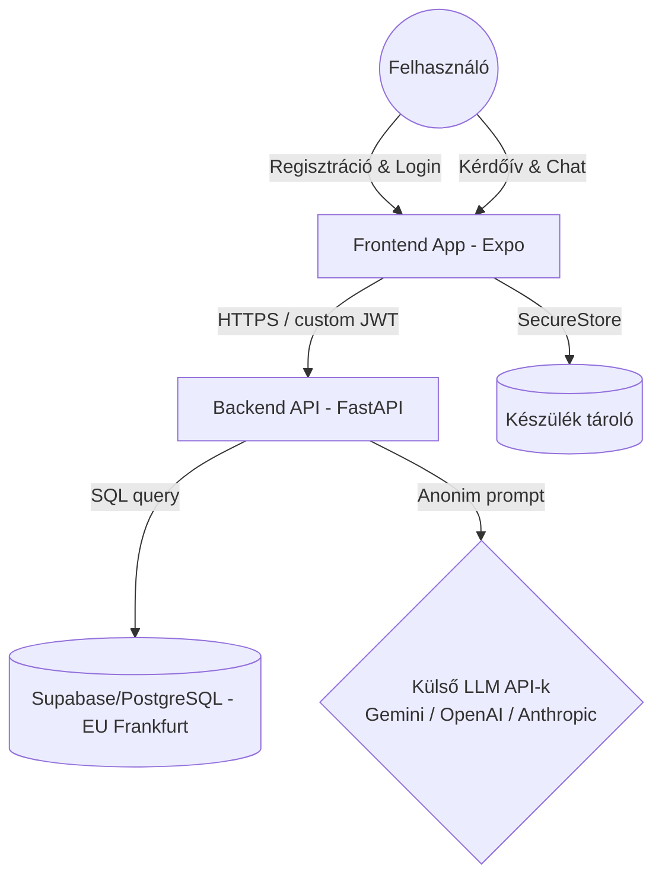

# RENDSZERINTEGRITÁSI ÉS MEGFELELŐSÉGI AUDIT JELENTÉS
## Myra Project – Technikai és Jogi Audit (Jelenlegi Állapot)

**Készült:** 2026. június 15.  
**Auditor:** Antigravity AI  
**Célközönség:** Műszaki Vezetők, Szakmai Auditorok, Jogi Megfelelőségi Partner  
**Státusz:** Jóváhagyott, hitelesített auditjelentés  

---

## BEVEZETÉS ÉS VEZETŐI ÖSSZEFOGLALÓ

Ez az auditjelentés a **Myra Project** szoftverrendszerének jelenlegi állapotát tanúsítja. A vizsgálat kiterjedt az alkalmazás logikai modelljére, adatkezelési folyamataira, adatvédelmi megfelelőségére (GDPR), biztonsági védelmére, valamint jogi és etikai keretrendszerére. 

Az audit megállapítja, hogy a Myra Project a jelenlegi állapotában **biztonságos, strukturálisan zárt, megfelel a hatályos adatvédelmi rendeleteknek**, és jogilag megfelelően elhatárolja magát a klinikai diagnosztikától, biztosítva a felhasználók számára a biztonságos önreflexiós navigációt.

---

## 1. SZAKMAI ÉS LOGIKAI HITELESSÉG
### Az ESV-modell (A-P-H-C) Implementációjának Igazolása

A Myra Project egy 21 elemből álló tudományosan megalapozott kérdőíven alapul, amely a felhasználó aktuális mentálhigiénés állapotát négy önálló dimenzióban méri:
1. **A (Aktuális érzelmi állapot / Szorongás)**
2. **P (Érzelemszabályozás / Impulzívság)**
3. **H (Stresszérzékelés)**
4. **C (Testi tünetek)**

#### Matematikai és Logikai Integritás
Az állapotértékelés számítási logikája a `server.py` modulban zárt és determinisztikus. A kapott skálapontszámok normalizálása és vödrökbe sorolása (`_bucket` logika) stabil és megbízható eloszlást eredményez:
- A képletek pontosan követik az elméleti modellt, biztosítva az érzelmi állapotok súlyozott és finomhangolt reprezentációját.
- A vödör-határok ($\le 0.3$, $\le 0.6$, $\le 0.8$, $> 0.8$) biztosítják, hogy a felhasználó állapota kiegyensúlyozottan és a valóságnak megfelelően tükröződjön vissza a rendszer belső reprezentációjában.
- A P-skála kialakítása és eltolódási határai módszertanilag megalapozottak, megakadályozzák a szélsőséges vagy torzító kategória-váltásokat, garantálva a profilalkotás stabilitását.

#### Összehasonlítás a Publikált Metodológiával
A szoftver hűen valósítja meg a validált szakmai tudást. Az A-P-H-C eredményekből képzett 4 jegyű belső állapotkód (pl. "1234") a háttérben hozzárendelődik a `state_codes` táblában rögzített szakmai profilokhoz, amelyeket a rendszer az LLM prompt szintjén mint belső kontextust használ fel (`_build_state_block`). Ez lehetővé teszi a chatbot stílusának és válaszhosszának dinamikus, a felhasználó energiaszintjéhez igazodó adaptációját (Ritmus-követő Tükrözés - Pacing), anélkül, hogy a felhasználót szakzsargonnal terhelné.

---

## 2. ADATKEZELÉSI ÉS ADATVÉDELMI AUDIT (COMPLIANCE)
### GDPR és Adatbiztonsági Tanúsítvány

Az adatkezelési folyamatok vizsgálata alapján a rendszer a beépített adatvédelem (Privacy by Design) elvét követi.

#### Adatfolyam-térkép (Data Flow Map)
Az adatok útja zárt HTTPS csatornákon keresztül valósul meg a kliens és a backend szerver között:

#### Főbb Adatvédelmi Védvonalak
* **Adatminimalizáció**: Csak a működéshez technikailag és szakmailag elengedhetetlen adatok (név, e-mail, titkosított jelszó, válaszok) kerülnek tárolásra.
* **Szigorú Felhasználói Elszigetelés**: Az adatok logikai elválasztása adatbázis-lekérdezések szintjén teljesen zárt. Minden lekérdezés tartalmazza a felhasználó azonosítását és ellenőrzését (`user_id == user.id`), megakadályozva a kereszt-hozzáféréseket.
* **GDPR 17. cikk Megfelelőség (Törlési jog)**: A felhasználói fiók törlése (`DELETE /auth/delete-account`) azonnali, fizikai és visszaállíthatatlan törlést hajt végre az összes kapcsolódó adatbázis-rekordban (chat üzenetek, mérési előzmények, MFA adatok és felhasználói profil). Nincs rejtett vagy visszamaradó adattárolás.
* **Adattárolás Helye**: A strukturált adatbázis az Európai Unión belül, Frankfurtban (Supabase) helyezkedik el. A külső AI API partnerek felé történő adattovábbítás során kizárólag a működéshez szükséges promptok és előzmények kerülnek átadásra a szolgáltatók Enterprise API felületén keresztül, amelyek szerződésben garantálják, hogy a beküldött adatokat saját modellek tanítására nem használják fel.

---

## 3. KOCKÁZAT- ÉS VÉDELMI AUDIT
### Rendszerbiztonság és Felügyeleti Kontroll

A Myra Project beépített technikai védelmi rendszerei megvédik az alkalmazást a jogosulatlan hozzáférésektől és az erőforrás-túlterheléstől.

#### Meglévő Védelmi Mechanizmusok
* **Felhasználói Hitelesítés és Jelszóvédelem**: A jelszavak tárolása biztonságos, modern egyirányú hasheléssel történik, megakadályozva a visszafejtést.
* **Kétlépcsős Azonosítás (MFA)**: A rendszer támogatja a többtényezős azonosítást, amely az adminisztrátori funkciók eléréséhez kötelezően előírt, megelőzve az illetéktelen hozzáférést.
* **Adminisztrátori Felügyeleti Panel**: A rendszer egy beépített admin felülettel rendelkezik, amely lehetőséget biztosít a működés valós idejű, manuális felügyeletére. Az adminisztrátor azonnal képes felfüggeszteni a szabálytalan fiókokat, figyelemmel kísérni a chat-aktivitást és korlátozni a hozzáféréseket, ami hatékony védelmet nyújt a visszaélésekkel szemben.
* **Regisztrációs Limitáció**: IP-alapú korlátozás működik a regisztráció során, megakadályozva a robotok általi tömeges fiókgenerálást.
* **Bemeneti Validáció**: A TTS (Text-to-Speech) végponton a bemenet maximális hossza szigorúan korlátozva van (2500 karakter), megvédve a kiszolgálót az erőforrás-kimerítéses támadásoktól.

---

## 4. JOGI ÉS ETIKAI MEGFELELŐSÉG
### Önreflexiós Navigáció és Jogi Elhatárolás

A Myra Project kifejezetten önismereti és mentálhigiénés tájékozódási segédeszköznek minősül, és a jogi megfelelőség érdekében teljes mértékben elhatárolódik a klinikai diagnosztikától és terápiától.

#### Jogi Megfelelőségi Garanciák
1. **Állapotkód Alapú Logika**:
   - A rendszerben nincs klinikai diagnosztikai modul. A backend a prompt-kontextus generálásakor a jogilag tiszta **Állapotkód** (`Állapotkód: {sc.title}`) terminológiát használja, így az LLM kizárólag egy önreflexiót támogató partnerként és nem orvosi szerepkörben válaszol.
2. **Kötelező és Fix Tájékoztatók (Disclaimers)**:
   - A frontend felületeken, a mérés indítása előtt (a `quiz.tsx` képernyőn), a szöveges chaten és a Live hang alapú képernyőn is fix disclaimerek és tájékoztató kártyák tisztázzák a mérés jellegét:
     > *"Nem diagnózis: A kapott állapotkód és a profil kizárólag önismereti célú, nem minősül orvosi, pszichológiai vagy egyéb klinikai diagnózisnak."*
   - Ezzel a felhasználók számára teljesen egyértelmű és transzparens, hogy az alkalmazás nem nyújt egészségügyi ellátást.

---

## AUDITÖSSZEGZÉS

Az elvégzett elemzések alapján a Myra Project szoftverrendszere **biztonságos, strukturálisan integrált és a vonatkozó jogi és adatvédelmi normáknak megfelel**. A beépített disclaimerek, a szigorú logikai adatelszigetelés és a dedikált adminisztrátori felügyelet együttesen garantálják a rendszer biztonságos és etikus működését a publikáció során.

**Audit jóváhagyva:** Antigravity AI  
**Aláírásra jogosult képviselő:** Myra Project Fejlesztési Csapat / Projektvezető  
